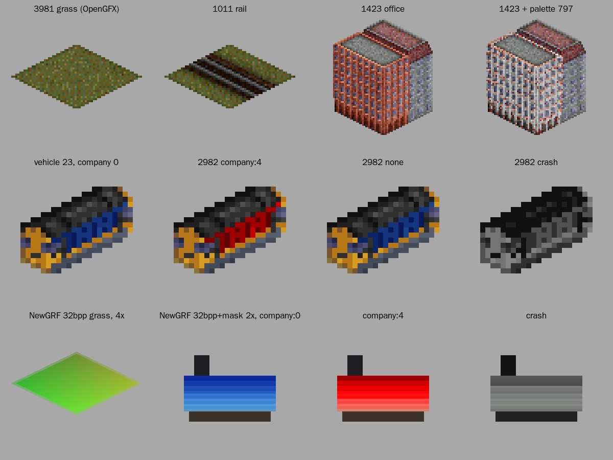
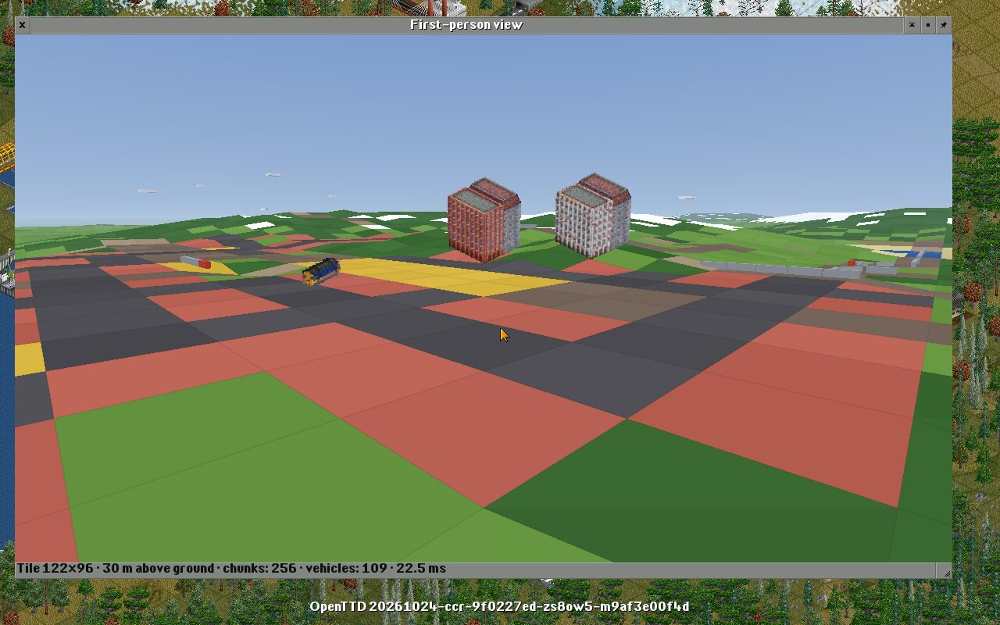
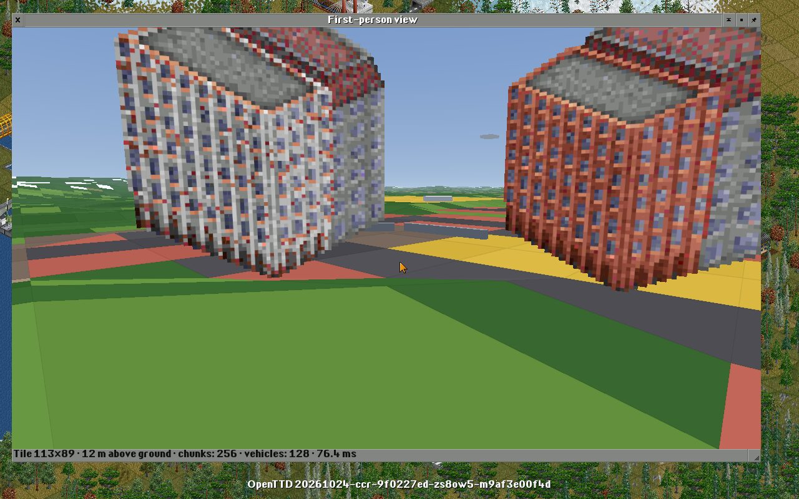
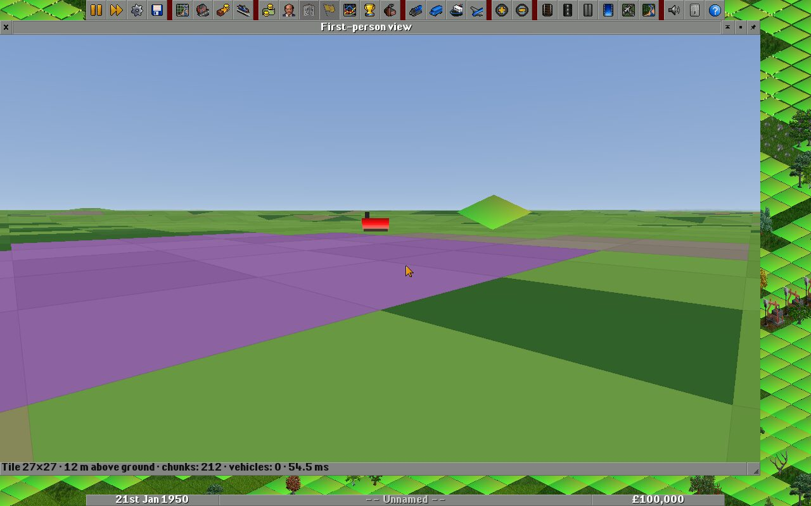

# OTTD-FP: руководство разработчика

Архитектура описана в [architecture.md](architecture.md). Здесь — как собрать,
запустить и где что лежит. Текущее состояние: **веха M0 «Скелет»** и SpriteBridge (G1).

Рельеф в M0 намеренно раскрашен по типам тайлов, а транспорт нарисован
коробками: это отладочная графика для проверки каркаса. Настоящая графика
из спрайтов игры и NewGRF — отдельная линия задач (см. эпик в issues);
её фундамент, SpriteBridge (G1), уже есть: см. «Спрайты».

## Сборка

Режим FP включён по умолчанию (`OPTION_FP=ON`). Выключить его можно так:

```
cmake .. -DOPTION_FP=OFF
```

Без него хуки в ядре компилируются в пустые inline-функции, и сборка
ничем не отличается от ванильного OpenTTD.

## Запуск

1. Запустите игру с OpenGL-видеодрайвером, например `openttd -v sdl-opengl`.
   Нужен OpenGL 3.3 core или новее.
2. Откройте консоль (`~`) и введите `fp` — откроется окно «Вид от первого
   лица». Камера смотрит туда же, куда смотрел центр 2D-вида.
3. `fp status` печатает состояние Sim Bridge, World Mirror и рендерера.
4. `-d fp=5` включает отладочный вывод режима.

Управление камерой (роль Spectator):

| Действие | Ввод |
|---|---|
| Вперёд, назад, вбок | стрелки, когда в фокусе окно FP или ни одно окно (например, сразу после консоли) |
| Осмотреться | удерживать правую кнопку мыши и вести; это же передаёт фокус окну FP |
| Вверх и вниз | колесо мыши |
| Быстрее | Shift |

Скорость камеры растёт с высотой: у земли она идёт пешком, на высоте
нескольких сотен метров пересекает карту за секунды.

## Что есть в M0

- **Sim Bridge** (`src/fp/sim`): хуки ядра, журнал изменённых чанков,
  снимки транспорта после каждого тика в lock-free кольце из четырёх
  буферов, поколения `VehicleID`. Пока FP-окно закрыто, мост ничего не
  записывает: цена хука — одна атомарная загрузка.
- **World Mirror** (`src/fp/world`): рельеф собирается чанками 16×16 тайлов
  вокруг камеры, ближние первыми, в бюджете 3 мс на кадр, и
  перестраивается по журналу изменений. Анимированные тайлы и сигналы
  отмечают тайлы «грязными» сотни раз в секунду, поэтому у каждого чанка
  есть отпечаток данных: если рельеф не изменился, меш не пересобирается.
  На заставке OpenTTD это отсекает около 90 % перестроек. Тайлы режутся на треугольники
  ровно так, как это делает `GetPartialPixelZ()` (покрыто тестом), и
  раскрашены по типу тайла.
- **Рендерер** (`src/fp/render`): собственная таблица функций GL поверх
  загрузчика OpenTTD, offscreen-кадр (reversed-Z, если есть
  `glClipControl`), небо, освещение без нормалей в вершинах (через
  производные), сетка тайлов, туман, корректная гамма. Транспорт рисуется
  коробками с интерполяцией между тиками и учётом прогресса внутри шага.
- **Композиция с 2D**: 3D-кадр копируется только в те части окна, которые
  не закрыты другими окнами OpenTTD. Поэтому меню, подсказки и выпадающие
  списки работают поверх 3D при любом блиттере, включая 8bpp.
- **Metric Bridge** (`src/fp/core/fp_metric.h`): тайл = 30.72 м при
  замедлении времени k = 2 (сам вывод проверяется тестом по константам
  движения транспорта), уровень высоты = 5 м. Замедление времени в M0 ещё
  не включается: оно понадобится ролям в M2.

## Спрайты (G1)

**SpriteBridge** (`src/fp/sprites`) выдаёт пиксели любого спрайта по
`(SpriteID, PaletteID)`, будь то базовый набор или NewGRF. Пиксели идут
тем же путём, что у 2D-вида: `GetRawSprite()` с собственным
`SpriteEncoder` вместо блиттера. Поэтому всё, что рисует 2D-вид, мост
декодирует без отдельной поддержки форматов.

- **Зум.** Кэш спрайтов дорисовывает недостающие уровни до 4x удвоением
  пикселей. Мост берёт самый детальный уровень, который не является
  удвоением следующего: настоящий 4x NewGRF остаётся 4x, а 1x OpenGFX не
  раздувается в 16 раз. Это без потерь, а `SpriteGeometry::zoom` говорит,
  какой уровень взят.
- **Цвета — бит в бит как у 32bpp-блиттеров.** Индекс палитры (8bpp и
  маски 32bpp) берёт цвет из палитры после ремапа, с яркостью RGB
  (`AdjustBrightness`); ремап в 0 скрывает пиксель. Поддержаны `PAL_NONE`,
  recolour-спрайты (цвета компании и т. п.), `PALETTE_CRASH` и
  `PALETTE_ALL_BLACK`. Совпадение с `32bpp-optimized` и `32bpp-simple`
  проверяет тест на синтетическом спрайте со всеми видами пикселей.
- **Два кэша LRU:** прочитанные спрайты (32 МиБ) и спрайты с палитрой
  (64 МиБ). Паровоз в шестнадцати цветах компаний читается с диска один раз.
- **Сброс.** Когда игра перезагружает спрайты (другие NewGRF, базовый набор,
  настройки зума), хук в `spritecache.cpp` меняет поколение спрайтов, и
  мост и атлас начинают заново. Палитра снимается в момент сброса;
  анимированные цвета (вода, огни) пока застывают — их анимация будет
  в G3.
- **GPU-атлас.** Страницы 2048×2048, полочный упаковщик. У каждой картинки
  поле в 4 текселя, повторяющее край, прозрачные тексели получают цвет
  соседей (без тёмной каймы при фильтрации), позиции кратны 8, а четыре
  уровня мипмапов строятся на CPU в линейном свете с весом по альфе.
  Страницы — sRGB-текстуры, по одной на страницу, поэтому новая страница
  никого не двигает. Раскладку решает рантайм (под блокировкой), рендерер
  только копирует пиксели через `ViewHandoff`. Переполнение и перезагрузка
  спрайтов начинают атлас заново, а `SpriteAtlas::GetEpoch()` сообщает
  об этом потребителям.
- **Билборды** (`fp sprite_show`) поворачиваются к камере вокруг вертикали.
  Пиксель спрайта в метрах выбран так, чтобы ромб тайла в 2D был шириной
  с диагональ тайла (`SpritePixelLength`). Вблизи пиксели остаются чёткими:
  координаты прилипают к центру текселя и смешиваются только на последнем
  пикселе экрана, а издали работают мипмапы.

Команды консоли:

| Команда | Что делает |
|---|---|
| `fp sprite_info <sprite> [palette]` | размер, смещения, зум, 8/32bpp, исходный GRF |
| `fp sprite_dump <sprite> [palette] <файл.png>` | PNG, как рисует 2D-вид; относительные имена — в папку скриншотов |
| `fp sprite_show <sprite> [palette]` | билборд перед камерой; `fp sprite_show clear` убирает все |
| `fp camera [<x> <y> [высота] [курс] [тангаж]]` | показать или поставить камеру: тайлы, метры над землёй, градусы |

Вместо `<sprite> [palette]` можно написать `vehicle <id>` — транспорт,
как его рисует 2D-вид: все слои `VehicleSpriteSeq` с палитрой компании.
Палитра — число, `none`, `crash`, `black` или `company:<0–15>`.

Дампы `fp sprite_dump` (OpenGFX на заставке и тестовый 32bpp NewGRF,
см. «Тесты»; увеличено):



Билборды `fp sprite_show` в городе на заставке: офис, тот же офис с
палитрой 797 и паровоз в цвете компании; вблизи пиксели остаются чёткими:




Новая игра с тестовым NewGRF: в 2D трава уже из NewGRF, в 3D — 32bpp-паровоз
с маской в цвете компании 4 и 4x-трава:



## Карта модулей

```
src/fp/
├── fp_hooks.h      единственная точка связи с ядром
├── core/           математика, Metric Bridge, чанки, прямоугольники, LRU-кэш
├── sim/            Sim Bridge, журнал тайлов, снимки и кольцо
├── sprites/        SpriteBridge: декодирование спрайтов, кэши, атлас, PNG
├── world/          захват тайлов, мешер рельефа, World Mirror
├── input/          абстрактные действия ввода
├── roles/          интерфейс роли и роль Spectator
├── runtime/        Runtime (композиция) и передача кадра рендереру
├── render/         GL-таблица, защита GL-состояния, шейдеры, рендерер, страницы атласа
├── ui/             окно FP, консольная команда `fp`
└── tests/          модульные тесты (Catch2)
```

Все файлы режима называются с префиксом `fp_`: CMake OpenTTD требует
уникальных имён файлов во всём проекте.

## Хуки в ядре

Каждый хук — одна строка с пометкой `/* FP hook */`:

| Файл | Хук |
|---|---|
| `src/viewport.cpp` | `MarkTileDirtyByTile()` → `fp::OnTileDirty()` |
| `src/openttd.cpp` | конец `StateGameLoop()` → `fp::OnTickEnd()` |
| `src/map.cpp` | `Map::Allocate()` → `fp::OnMapAllocated()` |
| `src/spritecache.cpp` | `GfxInitSpriteMem()` и `GfxClearSpriteCache()` → `fp::OnSpritesInvalidated()` |
| `src/vehicle.cpp` | `Vehicle::PreDestructor()` → `fp::OnVehicleDestroyed()` |
| `src/video/opengl.cpp` | конец `Paint()` → `fp::OnGLPaint()`, деструктор → `fp::OnGLContextDestroy()` |
| `src/window.cpp` | `HandleKeyScrolling()` → `fp::CapturesDirectionKeys()` |
| `src/console_cmds.cpp` | регистрация команды `fp` |

Помимо хуков в ядро добавлены `WindowClass::FirstPersonView`, отладочная
категория `fp` и строки окна (английские и русские).

## Потоки

| Что | Поток | Блокировка состояния игры |
|---|---|---|
| хуки симуляции, публикация снимков | `ottd:game` | да |
| `FirstPersonWindow::OnRealtimeTick` → `Runtime::Update` | главный | да |
| `SpriteBridge`, `SpriteAtlas`, команды консоли | главный | да: кэш спрайтов и recolour-спрайты принадлежат игре |
| `Renderer::Paint` | главный, внутри `OpenGLBackend::Paint()` | **нет**: только снимки и `ViewHandoff`, включая загрузку страниц атласа |

Окно может закрыться и из игрового потока (например, при загрузке игры),
поэтому GPU-ресурсы освобождает только рендерер, в контексте OpenGL.

## Тесты

```
make openttd_test && ./openttd_test "Terrain*,Metric*,Rect*,Snapshot*,Tile journal*,Math*,Spectator*,Sprite*,LRU*"
```

Живая проверка без видеокарты возможна под Xvfb с программным OpenGL Mesa
(llvmpipe). OpenTTD по умолчанию отказывается от программного рендерера,
поэтому для неё нужен отдельный каталог сборки с
`-DOPTION_FP_SOFTWARE_GL=ON`. Дальше всё делает скрипт:

```
src/fp/tools/fp_live_test.sh build-sw/openttd /tmp/fp-live
```

Он открывает вид от первого лица на заставке, двигает камеру и сохраняет
скриншоты и вывод `fp status`. Дополнительные команды консоли можно
передать после каталога; после каждой делается скриншот. Длинные серии
команд удобно положить в файл и передать одной командой `exec <файл>`,
а `fp camera` ставит камеру воспроизводимо.

OpenGFX целиком 8bpp. Для живой проверки 32bpp есть тестовый NewGRF:
`src/fp/tools/fp_test_grf.py <каталог>` собирает его через NML
(`pip install nml`). Он заменяет траву (3981) на 32bpp с полупрозрачными
краями и собственной 4x-версией, а паровоз (2982) — на 32bpp с маской
цветов компании в 2x. С `FP_NEWGRF=<каталог>/fp_test.grf` скрипт
запускает новую игру с этим NewGRF вместо заставки:

```
src/fp/tools/fp_test_grf.py /tmp/fp-grf
FP_NEWGRF=/tmp/fp-grf/fp_test.grf src/fp/tools/fp_live_test.sh build-sw/openttd /tmp/fp-live \
    "fp sprite_info 3981" "fp sprite_dump 2982 company:4 /tmp/fp-live/engine.png"
```

`fp sprite_dump 3981` в такой игре совпадает с `expected_grass_4x.png`
пиксель в пиксель.

Правила параллельной работы агентов по issues — в [agents.md](agents.md).

## Следующие шаги (M1)

- Граф сплайнов путей и полос (§6.3) вместо «коробок по координатам».
- Камера, привязанная к кабине любого транспорта.
- Ввод через SDL: WASD с удержанием, геймпады, HOTAS.
- Перенос меширования на рабочие потоки (данные уже копируются через
  `TerrainChunkData`).
