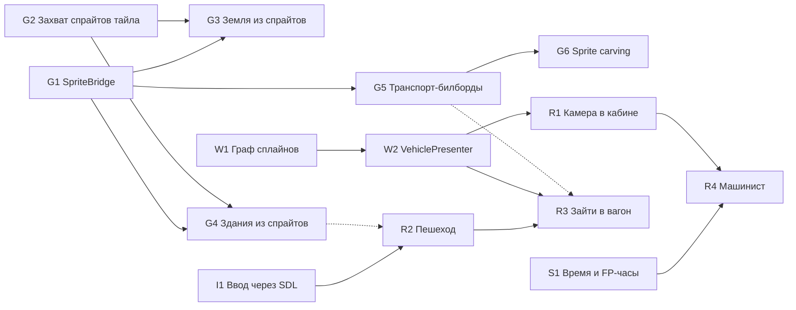

# OTTD-FP: бэклог задач

Задачи после M0, нарезанные так, чтобы их могли делать **параллельно
разные агенты**. Каждая задача самодостаточна: зачем, план с указателями
на код, где работать, зависимости, критерии приёмки. Общие правила — в
[agents.md](agents.md), архитектура — в [architecture.md](architecture.md).

Когда в репозитории включены Issues, каждая задача становится issue
(подзадачей эпика), а здесь остаётся ссылка на него.

## Запросы владельца проекта

1. **Поддерживать спрайты игры, включая NewGRF** → линия «Графика» (G1–G6).
   Принцип: не разбирать GRF самим, а брать графику тем же путём, что и
   2D-вид: кэш спрайтов, процедуры отрисовки тайлов, `Vehicle::GetImage()`.
   Тогда любой NewGRF — с колбэками, анимацией и перекраской — работает
   автоматически, без отдельной поддержки.
2. **Зайти человеком в вагон** → R3 (через ввод I1, пешехода R2 и позы
   вагонов W2).
3. **Разбить работу для параллельных агентов** → этот бэклог и эпик.

## Порядок и параллельность

Пунктир — мягкая зависимость: можно начинать раньше с заглушкой.

| Волна | Можно брать сразу | Что разблокирует |
|---|---|---|
| 1 | **G1, G2, W1, I1, S1, E1, E2** | всё остальное |
| 2 | G3, G4, G5 (после G1/G2), W2 (после W1), R2 (после I1) | |
| 3 | G6, R1, R3, R4 | |

Метки: `fp` у всех, плюс область (`graphics`, `world`, `motion`,
`roles`, `input`, `sim`, `engine`, `infra`), `research` и `needs-design`
где указано, `user-request` для запросов владельца.

---

## G1. SpriteBridge: пиксели любых спрайтов (база и NewGRF) и GPU-атлас

Метки: `fp`, `graphics`, `user-request`. Зависимости: нет.

**Зачем.** 3D-вид пока рисует отладочные цвета и коробки. Любой
настоящей графике нужны пиксели спрайтов. Это фундамент для G3–G6.

**План.**
- Новый модуль `src/fp/sprites/`: `SpriteBridge` выдаёт декодированное
  RGBA-изображение по `(SpriteID, PaletteID)`.
- Источник — кэш спрайтов OpenTTD, где уже лежат базовый набор и все
  NewGRF: свой `SpriteEncoder` и вызов
  `GetRawSprite(sprite, SpriteType::Normal, &allocator, &encoder)`
  (`src/spritecache.h`). Так уже поступает OpenGL-бэкенд для курсоров
  (`OpenGLBackend::Encode`, `src/video/opengl.cpp`). В `Encode()`
  приходит `SpriteLoader::SpriteCollection` по уровням зума, пиксели
  `CommonPixel {r, g, b, a, m}`, где `m` — индекс палитры (8bpp и
  перекрашиваемые области 32bpp).
- Брать самый детальный зум (`ZoomLevel::Min`, 4x), иначе следующий.
- Перекраска по `PaletteID` (цвета компании, recolour-спрайты),
  так же как блиттеры: 8bpp — палитра после ремапа; 32bpp с `m != 0` —
  ремап с сохранением яркости (см. реализацию в `src/blitter/40bpp_anim.cpp`,
  `32bpp_base`).
- LRU-кэш декодированных изображений; GPU-атлас (массив текстур или
  упаковщик «полками»), регион: слой/текстура, UV, размер и смещение в
  пикселях.
- Инвалидация при перезагрузке NewGRF и смене базового набора: найти,
  где OpenTTD сбрасывает свой кэш (`GfxClearSpriteCache` и вызывающие),
  добавить хук по правилам agents.md.
- Потоки: `GetRawSprite` — только под блокировкой состояния игры (в
  `Runtime::Update`); загрузка в GPU — в рендерере; передача — через
  `ViewHandoff`, как у чанков.
- Консоль: `fp sprite_dump <id> [palette] <файл.png>` (PNG через libpng,
  см. `src/screenshot_png.cpp`) и `fp sprite_show <id>` — показать
  спрайт билбордом перед камерой.

**Где работать.** `src/fp/sprites/` (новый); аддитивно —
`src/fp/runtime/fp_view_handoff.*`, `src/fp/render/` (текстуры),
`src/fp/ui/fp_console.cpp`.

**Критерии приёмки.**
- `fp sprite_dump` для травы, рельса, дома и локомотива даёт PNG как в
  2D-виде на OpenGFX, у транспорта — правильные цвета компании.
- 8bpp и 32bpp: живая проверка с тем, что есть в окружении, плюс
  модульный тест декодирования и ремапа на синтетическом `SpriteCollection`.
- `fp sprite_show` показывает спрайт в 3D (скриншот живого теста).

---

## G2. Захват спрайтов тайла через его draw_tile_proc — ванильные и NewGRF одинаково

Метки: `fp`, `graphics`, `user-request`. Зависимости: нет.

**Зачем.** Чтобы любой тайл (рельсы, дороги, дома, станции, заводы,
объекты — включая NewGRF с колбэками и анимацией) выглядел в 3D как в
игре, нужно знать, какие спрайты игра на нём рисует и где. Повторять
логику отрисовки нельзя: её тысячи строк, и она зависит от NewGRF.
Нужно **записать то, что рисует сама игра**.

**План.**
- 2D-вид рисует тайл через
  `_tile_type_procs[type]->draw_tile_proc(TileInfo *)`
  (`ViewportAddLandscape`, `src/viewport.cpp`). Процедуры складывают
  спрайты в статический `_vd`:
  - `DrawGroundSprite` / `DrawGroundSpriteAt` → `tile_sprites_to_draw`
    (экранные координаты);
  - `AddSortableSpriteToDraw` → `parent_sprites_to_draw` с **мировым
    bounding box** `xmin..zmax` (`src/viewport_sprite_sorter.h`);
  - `AddChildSpriteScreen` → дочерние спрайты относительно родителя;
  - фундаменты — `_vd.foundation*`.
- В конец `src/viewport.cpp` под `#ifdef WITH_FP` — функция
  `CaptureTileSprites(TileIndex, TileSpriteCapture &)`: сохранить и
  очистить `_vd`, подставить `_cur_ti` и `_cur_dpi` (зум
  `ZoomLevel::Min`, область вокруг тайла), вызвать `draw_tile_proc`,
  переложить результат в нейтральную структуру
  `src/fp/world/fp_tile_sprites.h` (ground-спрайты в координатах тайла,
  родительские спрайты с BB, дочерние, фундамент), восстановить `_vd`.
- Учесть: прозрачность и невидимость (рисовать как непрозрачное), без
  `DrawTileSelection`, мосты над тайлом, только под блокировкой.
- Встроить в захват чанка (`src/fp/world/fp_tile_capture.*`): `SpriteID`
  тайла входят в отпечаток чанка, чтобы анимация и смена графики
  пересобирали чанк.
- Замерить стоимость захвата чанка 16×16, описать в PR.
- Консоль: `fp capture <x> <y>` печатает спрайты тайла.

**Где работать.** `src/viewport.cpp` (одна функция), `src/fp/world/`,
`src/fp/fp_hooks.h`.

**Критерии приёмки.**
- Для рельса, дороги, дома, станции, завода, объекта и моста на заставке
  `fp capture` выдаёт те же спрайты, что 2D-вид.
- Путь одинаков для NewGRF (проверить на любом доступном NewGRF или
  обосновать по коду).
- После захвата 2D-вид рисуется как прежде (тест или живой скриншот).

---

## G3. Настоящая земля: ground-спрайты, развёрнутые из изометрии на рельеф

Метки: `fp`, `graphics`, `user-request`. Зависимости: G1, G2.

**Зачем.** Ground-спрайты — трава, рельсы, дороги, вода, поля, пустыня,
снег, ВПП, платформы — это почти вся «картинка» карты. Они заменят
отладочную раскраску.

**План.**
- Ground-спрайт нарисован в изометрии ромба тайла с учётом склона.
  Обратное отображение: точка тайла `(fx, fy)` с высотой из
  `GetTerrainSurfaceHeight()` → экранная точка по `RemapCoords`
  (`src/landscape.h`) → пиксель спрайта. Получается текстура тайла
  «сверху» (64×64 или 128×128).
- На GPU: запекание текстуры чанка (16×16 тайлов) рендером в текстуру,
  каждый ground-спрайт — квад с обратной проекцией; mip-карты;
  пересборка по журналу и отпечатку.
- Фундаменты под зданиями на склонах, полутайлы, оверлеи рельсов, дорог и
  контактной сети; вода (анимацию палитры — позже).
- Отладочную раскраску оставить переключателем `fp debug_colours on|off`.

**Где работать.** `src/fp/world/` (данные), `src/fp/render/`
(запекание, шейдер рельефа).

**Критерии приёмки.**
- Вид камеры сверху похож на 2D-карту: рельсы, дороги, вода и поля
  различимы. Скриншоты до и после на заставке.
- Кадр на живом тесте не медленнее M0 более чем вдвое (замер в PR).

---

## G4. Здания, станции и объекты из спрайтов: коробки по bounding box с развёрткой изометрии

Метки: `fp`, `graphics`, `user-request`. Зависимости: G1, G2.

**План.**
- Родительские спрайты из G2 несут мировой BB → коробка в метрах.
  Высоты объектов — в `metres_per_unit`, а не в уровнях рельефа
  (architecture.md, §2.1).
- Грани: изометрический спрайт показывает две вертикальные грани
  (на юго-запад и юго-восток) и крышу. Пиксели спрайта
  «распроецировать» на эти грани по BB (аффинно на каждую). Невидимые в
  2D грани — пока зеркально от видимых.
- Деревья — не коробки, а крест из двух квадов с alpha-test.
- Alpha-test для окон и ажурных конструкций; инстансинг одинаковых
  `(SpriteID, BB)`.
- Отдать BB рантайму как коллизионные коробки для пешехода (R2).

**Где работать.** `src/fp/world/fp_buildings*` (новое), `src/fp/render/`.

**Критерии приёмки.**
- Город на заставке узнаваем в 3D; NewGRF-дома и станции отображаются;
  деревья есть.
- ≥ 60 FPS на настольной видеокарте на заставке (на llvmpipe — замер в PR).

---

## G5. Транспорт из спрайтов: билборды с выбором ракурса и цветами компании

Метки: `fp`, `graphics`, `user-request`. Зависимости: G1.

**Зачем.** Быстрый видимый результат: поезда, автобусы и самолёты — как
в игре, включая NewGRF.

**План.**
- Спрайт для любого направления даёт
  `Vehicle::GetImage(Direction, EngineImageType::OnMap, VehicleSpriteSeq *)`
  (с NewGRF-колбэками), палитра — `GetVehiclePalette(v)`.
- Колбэки — только под блокировкой. Предложение: снимок
  (`src/fp/sim/fp_snapshot.h`) хранит `VehicleSpriteSeq` текущего
  направления и палитру (то, что рисует 2D); рантайм по запросу
  дозаполняет кэш восьми ракурсов. Стоимость замерить.
- Рендер: вертикальный билборд (поворот только вокруг Z). Ракурс — по
  углу между камерой и направлением транспорта (8 направлений по 45°,
  как спрайты в Doom). Пиксели → метры через размер тайла на
  `ZoomLevel::Min` и Metric Bridge; длина вагона должна совпасть с
  `cached_veh_length`.
- Многослойные `VehicleSpriteSeq`, сочленённые части, винт вертолёта
  (сейчас отфильтрован в снимке).
- Коробки оставить за `fp debug_boxes`.

**Где работать.** `src/fp/sim/fp_snapshot.h` и `fp_bridge.cpp`
(аддитивно), `src/fp/render/` (проход билбордов).

**Критерии приёмки.**
- На заставке транспорт выглядит как в 2D с любого ракурса, цвета
  компании верные; скриншоты с трёх-четырёх сторон.
- NewGRF-транспорт работает (проверка или обоснование по коду).

---

## G6. Исследование: объёмный транспорт из восьми спрайтов (visual hull, «sprite carving»)

Метки: `fp`, `graphics`, `research`. Зависимости: G1, G5.

**Зачем.** Вблизи билборды плоские. Цель (architecture.md, §7, п. 3) —
автоматически получать 3D-форму любого NewGRF-транспорта из его
восьми ракурсов.

**План.**
- Воксели в объёме по BB; для каждого из 8 ракурсов (ортографическая
  диметрия OpenTTD) вырезать воксели вне силуэта; цвет — из ракурса, где
  воксель виден; меш — greedy meshing или marching cubes; кэш на диске по
  хэшу пикселей.
- Ограничения метода (вогнутости, короткие и сочленённые вагоны).
- Прототип: команда, строящая меш для выбранного двигателя, и показ рядом
  с билбордом.

**Критерии приёмки.** Отчёт `docs/fp/research/sprite_carving.md` со
скриншотами пяти и более ТС (поезд, вагон, автобус, грузовик, самолёт),
оценкой качества и стоимости и рекомендацией «внедрять или нет и как».

---

## W1. Граф сплайнов путей, дорог, трамваев и тротуаров

Метки: `fp`, `world`. Зависимости: нет.

**Зачем.** architecture.md, §6.3: основа плавного движения (W2), камеры в
кабине (R1), геометрии рельсов и навигации пешеходов.

**План.**
- Порты на серединах рёбер тайла; куски пути (`Track::X/Y/Upper/Lower/Left/Right`,
  `src/track_type.h`) — кубические сплайны Эрмита между портами;
  касательная — биссектриса с единственным соседом; на стрелках у
  каждой ветки своя кривая.
- Натуральная параметризация; отображение
  `SimPos (тайл, track, позиция в тайле) ↔ (кусок, s)`.
- То же для дорог (`RoadBits`; полоса шириной 3.5 м визуально, независимо
  от бокового смещения симуляции), трамваев и тротуаров вдоль городских
  дорог.
- Высоты по рельефу, фундаментам, мостам, тоннелям.
- Инкрементальное обновление по журналу тайлов.
- Отладка: `fp debug_splines on` рисует линии.

**Где работать.** `src/fp/world/fp_splines*` (новое), `src/fp/tests/`.

**Критерии приёмки.**
- Тесты G1-непрерывности на прямых, кривых, S-образных участках и
  стрелках; тест обратного отображения для всех `Track`.
- На заставке отладочные линии ложатся на рельсы и дороги (скриншоты).

---

## W2. VehiclePresenter: транспорт на сплайнах — тележки, повороты, сочленения

Метки: `fp`, `motion`. Зависимости: W1.

**План** (architecture.md, §8).
- Часть состава → `(кусок, s)` на графе W1 с учётом прогресса внутри
  шага; передняя и задняя тележки на ±L/2; ориентация кузова по ним;
  возвышение наружного рельса в кривых.
- Автомобили: `state/frame` (`RVSB_*`) → полоса, повороты, обгон.
- Самолёты: сглаженный курс, крен, тангаж; по земле пока по координатам.
- Результат — полная поза (позиция + ориентация) каждой части. Её
  используют билборды и модели (G5), камера (R1) и пешеход в вагоне (R3).
- Перенести логику из `Renderer::BuildBoxes` в `src/fp/motion/`.

**Критерии приёмки.** Поезд на заставке проходит кривые и стрелки без
изломов, вагоны не расходятся и не налезают (серия скриншотов);
тесты поз.

---

## R1. Камера в кабине любого транспорта (M1 «Кабина-наблюдатель»)

Метки: `fp`, `roles`. Зависимости: W2 (мягкая: до неё — интерполированные
позиции из снимков).

**План.**
- Роль `Rider`: камера привязана к позе головной части; свободный осмотр
  мышью.
- Выбор: `fp ride <vehicle id>`; кнопка «Вид из кабины» в окне
  транспорта (`src/vehicle_gui.cpp`, по правилам хуков); позже — клик по
  транспорту в 3D.
- Выход в Spectator — клавишей.
- Тоннель (ТС скрыт): тёмный «тоннель» или сообщение, без провалов камеры.

**Критерии приёмки.** Поездка в кабине поезда и автобуса на заставке
плавная, без дрожания; скриншоты.

---

## R2. Пешеход: ходьба по миру, коллизии с рельефом, зданиями и транспортом

Метки: `fp`, `roles`, `user-request`. Зависимости: I1 (мягкая); коробки
зданий — после G4 (до этого грубые коробки по классу тайла).

**Зачем.** Запрос «быть обычным прохожим» и первый шаг к R3.

**План** (architecture.md, §9.4).
- Роль `Walker`: капсула 0.3 × 1.8 м, ходьба 1.4 м/с, бег 4 м/с,
  гравитация, прыжок, ступеньки до 0.4 м, склоны до 45°.
- Коллизии: рельеф (из данных чанков, не из карты в рендере), коробки
  зданий и объектов, транспорт — движущиеся OBB из снимков (толкают
  пешехода; симуляция о пешеходе не знает).
- `fp walk` или клавиша: Spectator ↔ Walker (опуститься на землю под
  камерой).
- В воду не входить.

**Где работать.** `src/fp/roles/fp_walker*`, `src/fp/physics/` (новое).

**Критерии приёмки.** На заставке можно пройтись по городу; нельзя пройти
сквозь дом и проезжающий транспорт и провалиться под рельеф; тесты
контроллера на плоскости, склоне, ступеньке и стене.

---

## R3. Зайти человеком в вагон: посадка, ходьба внутри движущегося поезда, высадка

Метки: `fp`, `roles`, `user-request`. Зависимости: R2, W2; мягкая — G5.

**Зачем.** Прямой запрос: «чтобы человеком я мог зайти в вагон».

**План.**
- Снимок: флаг «на погрузке» (`current_order.IsType(OT_LOADING)`), тип
  груза части (`cargo_type`) и вместимость.
- Двери у концов вагона (по длине части; позже — точки привязки model
  pack). Открыты, когда ТС стоит на погрузке; вход — «действие» (E) у
  двери.
- Интерьер — процедурно по типу груза и длине: пассажирский — проход,
  ряды кресел, окна; почтовый — стеллажи; крытый грузовой — пусто;
  открытые вагоны и цистерны — войти нельзя (сообщение). Геометрия — в
  локальной системе вагона.
- **Физика внутри — в системе координат вагона** (architecture.md,
  §9.5): пешеход движется относительно вагона, мир — через позу вагона
  из W2, без дрожания на ходу.
- Переходы между вагонами пассажирского состава.
- Сесть на место (камера пассажира) и встать.
- Выход на стоянке через дверь на платформу или землю.

**Где работать.** `src/fp/roles/` (посадка, пассажир),
`src/fp/interiors/` (новое), аддитивно — снимок.

**Критерии приёмки.** На заставке: подойти к стоящему поезду, войти,
пройти по вагонам, сесть, проехать перегон, выйти на следующей станции —
серия скриншотов; тесты преобразований систем координат.

---

## R4. Машинист: команды CMD_FP_*, ручная тяга и тормоз, сохранение (M2)

Метки: `fp`, `sim`, `roles`, `needs-design`. Зависимости: R1, S1.

Сначала короткий дизайн-документ в PR, затем реализация.

**План** (architecture.md, §5.3–5.5 и §9.1).
- `FPControl` — таблица по `VehicleID`; команды
  `CMD_FP_TAKE_CONTROL`, `CMD_FP_RELEASE_CONTROL`, `CMD_FP_SET_CONTROLS`
  (`src/command_type.h`, `DEF_CMD_TRAIT`).
- Хук в `GroundVehicle::GetAcceleration()` / `Train::UpdateSpeed`:
  доля тяги от позиции контроллера, тормоз.
- Остановка у платформы → `BeginLoading`; автостоп у запрещающего сигнала
  в духе АЛС.
- Чанк сохранения `FPCT` — только если не пуст.
- HUD: скорость, позиция контроллера, сигнал.
- Детерминизм: без float в симуляции, проверка рассинхронов.

**Критерии приёмки.** В одиночной игре можно провести поезд от станции до
станции; сохранение и загрузка с ручным управлением; ванильные сейвы без
FP-состояния не меняются; тест детерминизма (запись команд и повтор).

---

## I1. Слой ввода через SDL: WASD с удержанием, захват мыши, геймпад, основа для HOTAS

Метки: `fp`, `input`. Зависимости: нет.

**Зачем.** Сейчас есть только стрелки (`_dirkeys`) и правая кнопка мыши.
Пешеходу (R2, R3) нужны WASD с удержанием, бег, прыжок, «действие»;
дальше — геймпад и HOTAS (architecture.md, §14).

**План.**
- `src/fp/input/`: устройства → действия; расширить `InputState`
  (прыжок, присед, действие, бег…).
- Удержание клавиш: OpenTTD не сообщает об отпускании клавиш, кроме
  стрелок. При SDL-драйвере — `SDL_GetKeyboardState`; на Windows и macOS —
  свой путь за общей абстракцией.
- Захват мыши (относительное движение без кнопки) для пешехода;
  Esc отпускает.
- Геймпад и джойстик: SDL GameController/Joystick как подсистема ввода
  даже при не-SDL видеодрайвере; мёртвые зоны, калибровка.
- Привязки клавиш — в настройках.

**Где работать.** `src/fp/input/`; минимальные хуки в видеодрайверах,
если без них нельзя.

**Критерии приёмки.** WASD, бег, прыжок и E работают на Linux (SDL);
устройство абстракции годится для Windows и macOS; геймпад двигает
Spectator; тесты отображения устройств в действия.

---

## S1. Замедление времени и FP-часы: время суток, солнце, небо

Метки: `fp`, `sim`. Зависимости: нет.

**План.**
- Metric Bridge (architecture.md, §2.1): для ролей, где важна скорость,
  в одиночной игре — `_game_speed = 100 / k` (по умолчанию k = 2),
  восстановление при выходе; для сетевой игры — описать серверную
  настройку, не реализовывать.
- FP-часы: `tod = (TimerGameTick::counter · 27 мс · k / длина_FP_суток) mod 1` —
  детерминированно и одинаково у всех клиентов.
- Солнце, небо и освещение от времени суток; ночь темнее.
- Настройки раздела `[fp]` (`src/table/settings/fp_settings.ini`): k,
  метры на уровень, длина FP-суток, дальность обзора.

**Критерии приёмки.** В окне FP видна смена дня и ночи; `fp status`
показывает время; настройки сохраняются в `openttd.cfg`; поведение
`_game_speed` протестировано.

---

## E1. Меширование на рабочих потоках и LOD дальних чанков

Метки: `fp`, `engine`. Зависимости: нет (учитывать G3 и G4 как будущих
пользователей).

**План.** Захват остаётся под блокировкой, `MeshTerrainChunk` и будущие
мешеры — на пуле потоков; дальние чанки укрупнены (2×2 и 4×4 тайла);
горизонт; замеры на карте 4096×4096.

**Критерии приёмки.** На карте 2048×2048 облёт без провалов кадра (замер
в `fp status`), дальность 6 км и больше; тесты детерминизма LOD-мешей.

---

## E2. CI: сборка, тесты и живой тест FP под Xvfb со скриншотами

Метки: `fp`, `infra`. Зависимости: нет.

**План.** GitHub Actions `fp.yml`: Ubuntu, пакеты (SDL2, xvfb, xdotool,
imagemagick, openttd-opengfx), сборка с `-DOPTION_FP_SOFTWARE_GL=ON`,
`openttd_test`, `src/fp/tools/fp_live_test.sh`, артефакты (скриншоты и
логи), ccache; отдельная сборка с `-DOPTION_FP=OFF` (ванильность).
Запуск на PR.

**Критерии приёмки.** Зелёный прогон на PR; скриншоты в артефактах;
время прогона в описании PR.
